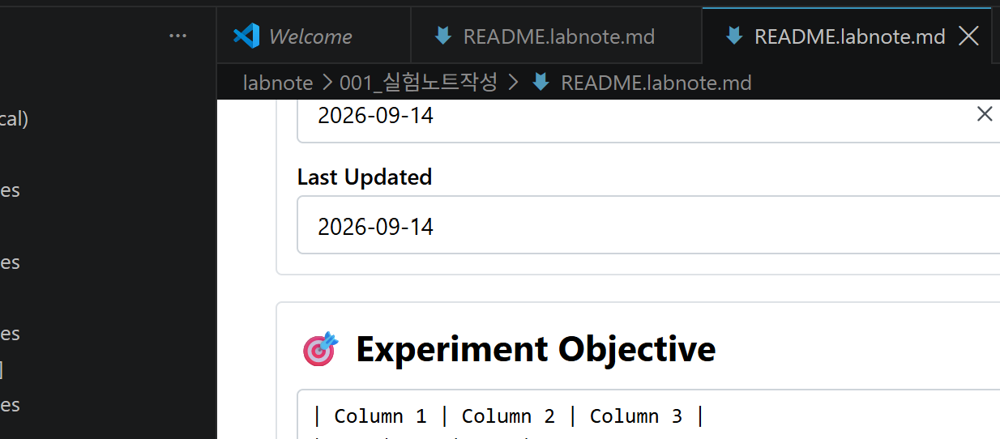

## 🎯 Experiment Objective
| Column 1 | Column 2 | Column 3 |
| --- | --- | --- |
|     |     |     |
|     |     |     |
|     |     |     |
> Briefly describe the main objective and hypothesis of this experiment.

## 🗂️ Related Workflows

- [x] [001 WD030 Growth Media Design](./001_WD030_Growth_Media_Design.labnote.md)
- [x] [002 WD060 Genetic Circuit Design - ㅇㄹㅇㄹㅇㄹㅇ](./002_WD060_Genetic_Circuit_Design.labnote.md)
- [ ] [003 WD050 DNA Oligomer Pool Design](./003_WD050_DNA_Oligomer_Pool_Design.labnote.md)

## Summary and Discussion

![[Pasted image 20261002112301.png]]